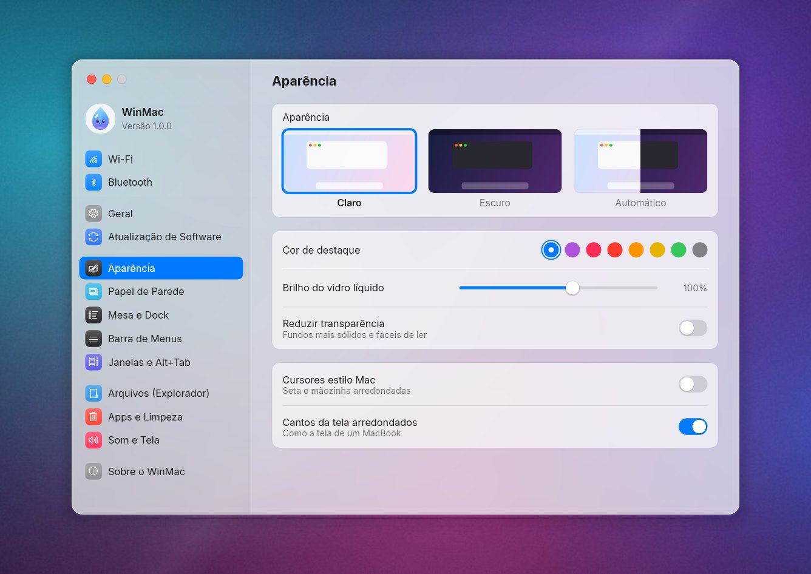
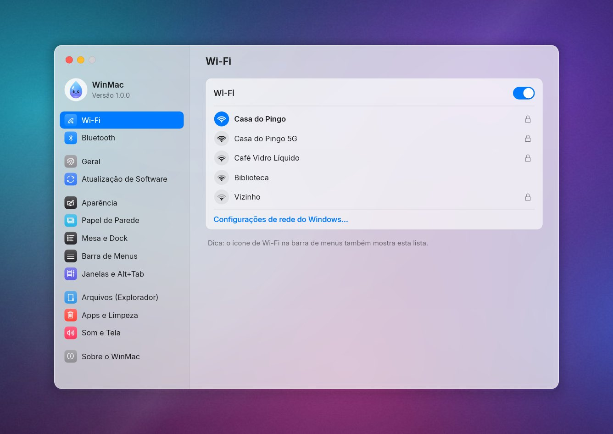
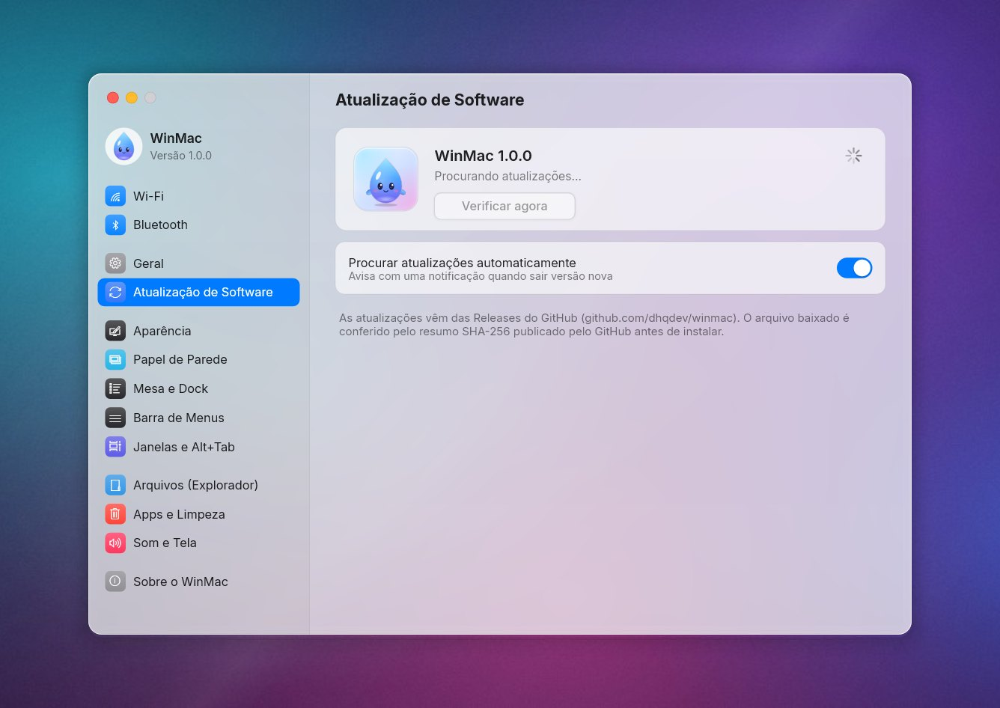
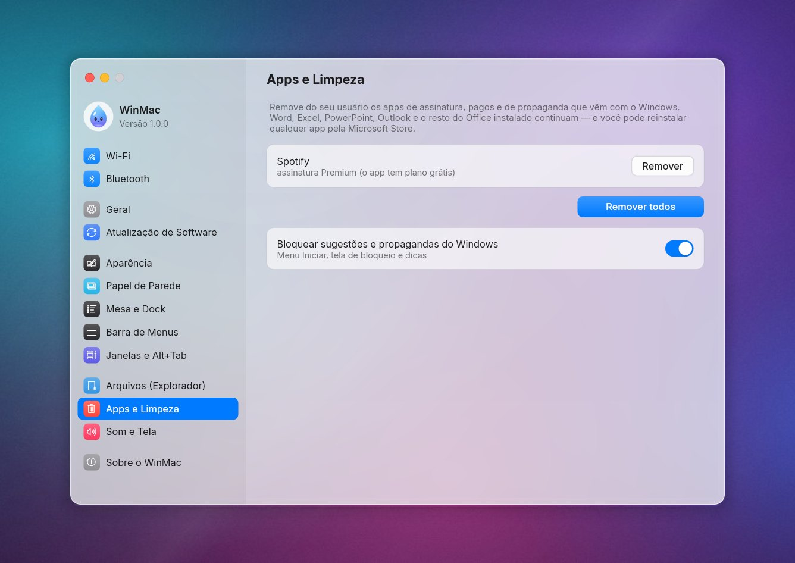
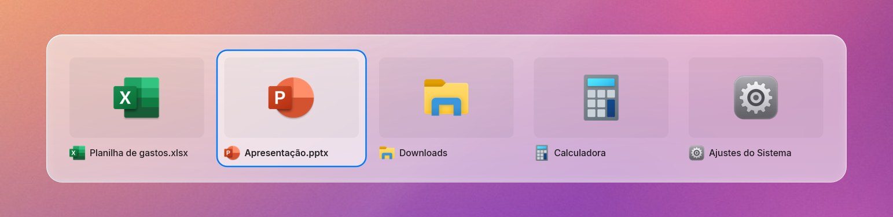
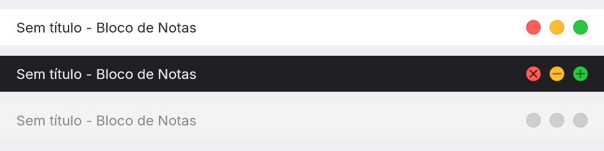
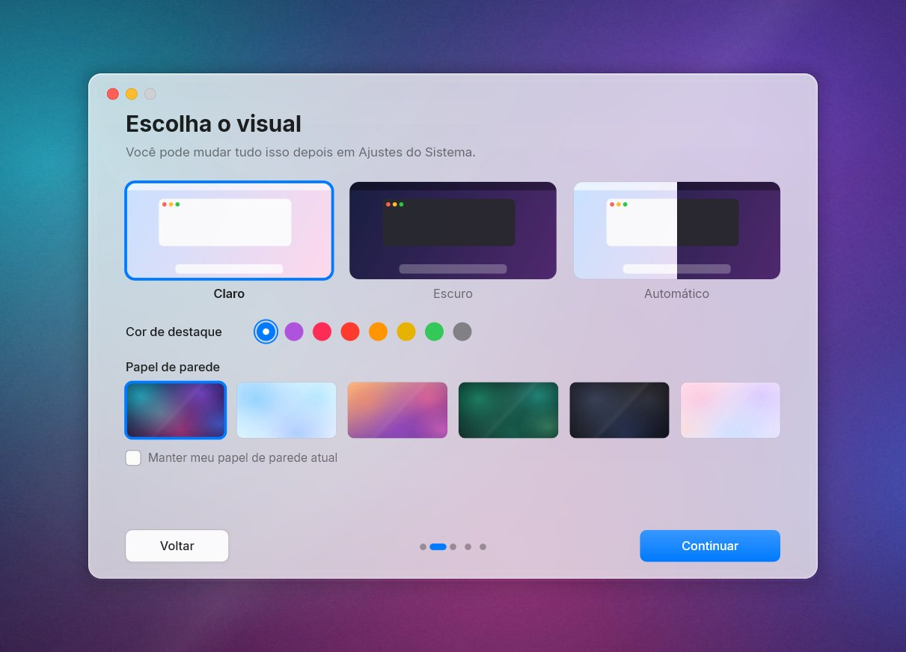
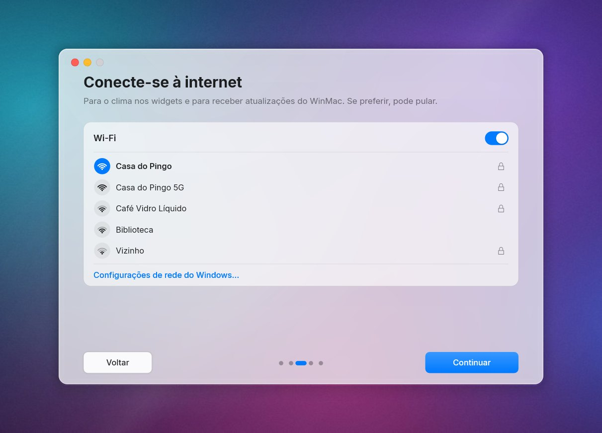
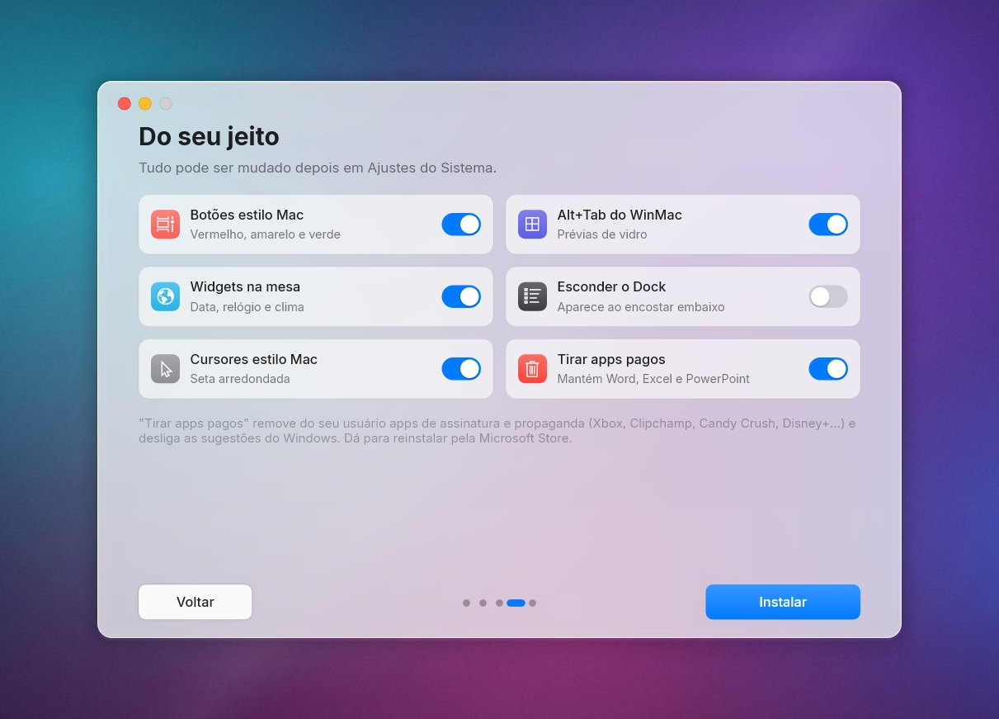
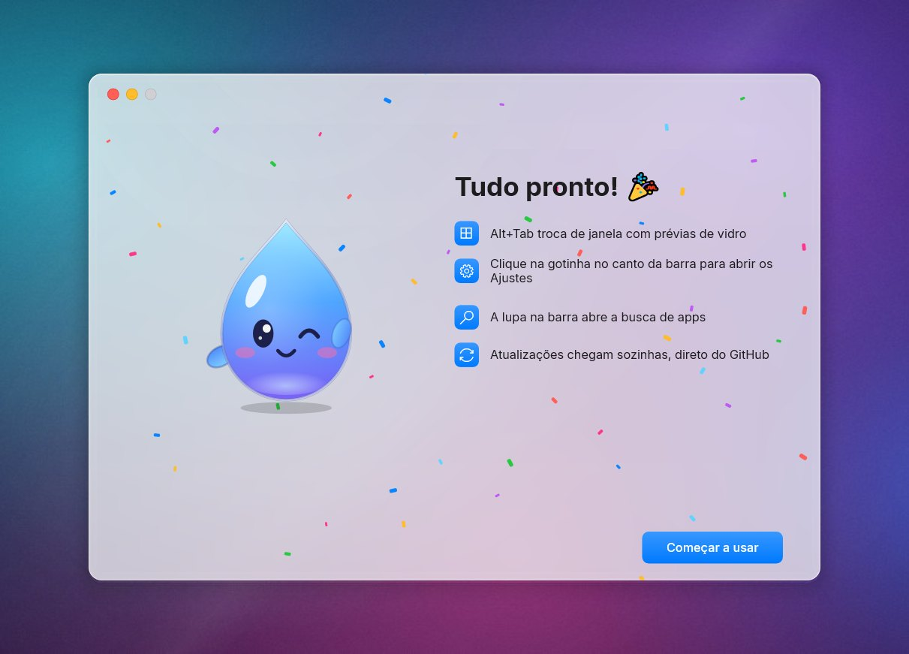

<div align="center">


# WinMac

**Um jeitinho de Mac no seu Windows.**<br>
Dock, barra de menus, Alt+Tab de vidro, botões coloridos nas janelas, widgets e vidro líquido — leve, nativo e sem propaganda.

[**⬇️ Baixar o WinMac**](https://github.com/dhqdev/winmac/releases/latest/download/WinMac-Setup.exe) &nbsp;·&nbsp; [Novidades](https://github.com/dhqdev/winmac/releases) &nbsp;·&nbsp; [Como funciona](#como-funciona)

<sub>Feito e testado no Windows 10 22H2 (deve funcionar no 11) · 64 bits · ~2,5 MB · instala só para o seu usuário, sem administrador</sub>

</div>

---


## Conheça o Pingo 💧

O Pingo é uma gotinha de **vidro líquido** que te recebe na instalação, acena nos Ajustes e comemora quando tudo fica pronto. Ele é desenhado em código, então fica nítido em qualquer tela.

## O que vem no WinMac

| | |
|---|---|
| 🧊 **Vidro líquido** | Dock, barra de menus, menus, Central de Controle e janelas com desfoque real do Windows, brilho especular, borda com leve dispersão de cor e reflexo. Dá para regular o brilho ou reduzir a transparência. |
| 🚥 **Botões estilo Mac** | Fechar, minimizar e ampliar em vermelho, amarelo e verde nas janelas dos apps, inclusive Chrome, Edge e Office (cinza quando a janela não está em foco, com ×, − e + ao passar o mouse). |
| 🔀 **Alt+Tab de vidro** | Painel com **prévias ao vivo** das janelas. Tab avança, Shift+Tab volta, Q/W fecha a janela selecionada e Esc cancela. Também tem o modo só com ícones, como no Mac. |
| ⚙️ **Ajustes do Sistema** | App próprio no estilo do macOS, sem precisar das Configurações do Windows: Wi‑Fi, Bluetooth, aparência, papel de parede (inclusive o Destaque do Windows), Dock, barra de menus, janelas, notificações, som (escolha da saída), tela, bateria e energia, mouse, armazenamento, Explorador, limpeza de apps e atualização. |
| 📶 **Wi‑Fi de verdade** | Lista de redes, conexão com senha e liga/desliga direto pela barra de menus, pelos Ajustes e na instalação. |
| 🔄 **Atualização pelo GitHub** | Quando sai versão nova aparece um aviso. Em **Ajustes › Atualização de Software › Atualizar agora**, o WinMac baixa, confere o SHA‑256 e se reinstala sozinho. |
| 🧹 **Sem apps pagos** | Remove apps de assinatura e propaganda (Xbox, Clipchamp, Candy Crush, Disney+…). **Word, Excel e PowerPoint continuam.** |
| 🖼️ **Papéis de parede próprios** | Seis papéis de parede gerados pelo app no tamanho exato da sua tela. |
| 🗂️ **Dock e barra de menus** | Ampliação dos ícones, apps abertos, pasta Downloads e Lixeira. Menus Arquivo/Editar/Janela que funcionam em qualquer app, bandeja, bateria e relógio. |
| 🌤️ **Widgets** | Data, calendário, relógio e clima (escolha a cidade nos Ajustes). |

<table>
<tr>
<td></td>
<td></td>
</tr>
<tr>
<td></td>
<td></td>
</tr>
</table>

### Alt+Tab



### Botões das janelas



### Instalação em quatro passos

<table>
<tr>
<td></td>
<td></td>
</tr>
<tr>
<td></td>
<td></td>
</tr>
</table>

### Papéis de parede


## Instalar

1. Baixe o [**WinMac-Setup.exe**](https://github.com/dhqdev/winmac/releases/latest/download/WinMac-Setup.exe).
2. Abra o arquivo. Se o Windows mostrar "O Windows protegeu o computador", clique em **Mais informações › Executar assim mesmo** (o app ainda não tem assinatura digital paga).
3. Siga o Pingo: visual, Wi‑Fi, escolhas e **Instalar**.

O WinMac fica em `%LOCALAPPDATA%\WinMac` e abre junto com o Windows. Para remover: **Ajustes › Geral › Desinstalar** (ou Configurações do Windows › Aplicativos › WinMac). Tudo volta como era: barra de tarefas, cursores, tema, papel de parede, sugestões do Windows e ajustes de mouse, energia e Explorador.

## Como funciona

- **Nativo e leve**: C++ com Win32 e Direct2D, sem .NET, Electron nem serviços em segundo plano. Parado, gasta perto de 0% de CPU: só redesenha quando algo muda.
- **Um único `.exe`**: o mesmo arquivo é o instalador, o Dock/barra, o app Ajustes (`--ajustes`) e o atualizador. A fonte Inter e os cursores vão embutidos.
- **Vidro**: o desfoque vem do próprio Windows (DWM); o WinMac desenha por cima o brilho, a refração e o contorno.
- **Botões das janelas**: o Windows 10 não deixa trocar esses botões sem mexer em arquivos do sistema. O WinMac localiza os botões reais de cada janela pela acessibilidade do Windows (UI Automation) e os cobre com uma camadinha da mesma cor da barra de título. Se não conseguir achar com segurança, deixa os botões originais. Não funciona em apps abertos como administrador; dá para desligar em **Ajustes › Janelas**.
- **Limites honestos**: os cantos das janelas dos *outros* apps continuam como o Windows 10 desenha, porque arredondá-los exigiria injetar código no gerenciador de janelas. Tudo o que o WinMac desenha é arredondado.

## Compilar

Precisa do Visual Studio 2022 (ou Build Tools) com a carga "Desenvolvimento para desktop com C++".

```bat
build.cmd
```

Gera `build\WinMac.exe` e `dist\WinMac-Setup.exe`. Outros comandos úteis:

| Comando | Para quê |
|---|---|
| `WinMac.exe --shell` | roda o Dock/barra direto da pasta de compilação |
| `WinMac.exe --ajustes [página]` | abre os Ajustes (`wifi`, `aparencia`, `update`, `dock`, `janelas`, `apps`…) |
| `WinMac.exe --welcome` | mostra as boas-vindas sem reinstalar |
| `WinMac.exe --export-art <pasta>` | exporta o Pingo, os ícones e os papéis de parede em PNG/JPG |
| `WinMac.exe --shots <pasta>` | gera as prévias das telas usadas neste README |

### Publicar uma atualização

1. Aumente a versão em `src/version.h`.
2. Rode `tools\release.cmd` (compila, cria a tag e publica `WinMac-Setup.exe` nas Releases).
3. Quem já tem o WinMac recebe o aviso e atualiza em **Ajustes › Atualização de Software**.

## Créditos

Feito por [@dhqdev](https://github.com/dhqdev). Código sob a licença [MIT](LICENSE). Fonte Inter (SIL OFL 1.1) e cursores do projeto apple_cursor (GPL‑3.0): veja [THIRD-PARTY.md](THIRD-PARTY.md).

WinMac é um projeto independente de fãs. Não tem relação com a Apple nem com a Microsoft. macOS é marca da Apple Inc.; Windows é marca da Microsoft Corporation.
